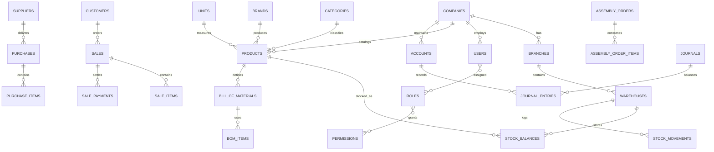

# DATABASE SCHEMA & ENTITY RELATIONSHIP DESIGN (ERD)

**Sistem ERP, POS, Inventori & Akuntansi Farmasi**  
**Database Engine:** PostgreSQL 18  
**Database Name:** `erp_farmasi_db`  
**Primary Key Convention:** UUID (v4) via `gen_random_uuid()`  
**Numeric Types:** `NUMERIC(15,2)` / `NUMERIC(18,2)` for Financial and `NUMERIC(15,4)` for Stock  

---

## 1. Entity Relationship Diagram (Mermaid)

---

## 2. Table Specifications & Data Dictionary

### Core & IAM
- `companies`: Multi-tenant organization header (`id`, `code`, `name`, `tax_number`, `currency`, `address`, `phone`).
- `branches`: Distribution hubs and retail pharmacy branches (`id`, `company_id`, `code`, `name`, `is_head_office`).
- `warehouses`: Physical storage facilities (`id`, `branch_id`, `code`, `name`, `type`: `GENERAL`, `COLD_CHAIN`).
- `users`: Authenticated user accounts (`id`, `company_id`, `branch_id`, `username`, `email`, `password_hash`, `full_name`, `is_active`).
- `roles` & `permissions`: Granular RBAC authorization definitions.
- `audit_logs`: Immutable BPOM & 21 CFR Part 11 audit records (`id`, `company_id`, `user_id`, `action`, `entity`, `entity_id`, `created_at`).

### Master Data
- `products`: Finished medicines, raw materials, or assembly packages (`id`, `code`, `barcode`, `name`, `type`, `purchase_price`, `selling_price`, `min_stock`).
- `categories`, `brands`, `units`: Classification taxonomy.
- `customers` & `suppliers`: Business counterparties with credit limits and terms of payment.
- `banks` & `payment_methods`: Bank accounts (BCA, Mandiri) and payment channels (Cash, EDC, QRIS, Bank Transfer).

### Inventory & Warehouse
- `stock_balances`: Real-time warehouse balance per product (`warehouse_id`, `product_id`, `qty`, `available_qty`, `avg_cost`).
- `stock_movements`: Immutable stock card audit log (`doc_type`, `doc_no`, `movement_type`, `qty`, `cost_per_unit`, `balance_after`).
- `stock_opname` & `stock_opname_items`: Periodic physical stock audits with variance calculations.
- `warehouse_transfers`: Multi-warehouse inter-facility logistics.

### Purchasing & AP
- `purchase_orders` & `purchase_order_items`: Supplier purchase orders (does not affect stock).
- `purchases` & `purchase_items`: Confirmed incoming purchase invoices (increments inventory stock and creates AP).
- `supplier_payments`: Accounts payable disbursements (reduces AP balance and creates cash/bank journals).

### Sales & AR
- `sales_orders` & `sales_order_items`: Customer orders (does not affect stock).
- `sales` & `sale_items`: Confirmed sales invoices & fast POS cashier transactions (decrements inventory stock and computes COGS).
- `sale_payments`: Multi-tender split payment records (Cash, Card, QRIS, Bank Transfer).
- `customer_payments`: Accounts receivable settlements (reduces AR balance and records cash/bank intake).

### Assembly & Production
- `bill_of_materials` & `bom_items`: Product recipes specifying components, scrap rates, and labor costs.
- `assembly_orders` & `assembly_order_items`: Production runs that consume component stock, produce finished goods, compute production unit costs, and create balanced production journals.

### Accounting & General Ledger
- `accounts`: Standard Indonesian GAAP / SAK Chart of Accounts (`code`, `name`, `type`: `ASSET`, `LIABILITY`, `EQUITY`, `REVENUE`, `EXPENSE`, `normal_balance`: `DEBIT`/`CREDIT`, `balance`).
- `journals` & `journal_entries`: Double-entry accounting records (`TOTAL DEBIT == TOTAL CREDIT`).
- `fixed_assets` & `asset_depreciations`: Straight-line depreciation tracking.
