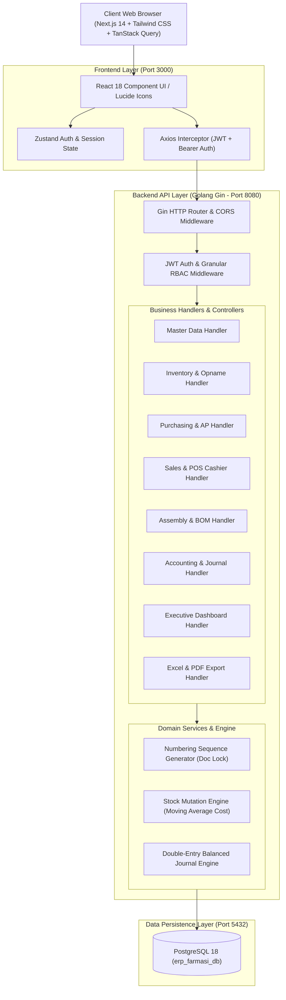

# SYSTEM ARCHITECTURE — PHARMACEUTICAL ERP, POS, INVENTORY & ACCOUNTING

**Sistem Enterprise Resource Planning Terpadu untuk Apotek & Distribusi Farmasi**  
**Functional Reference:** Ketoko Web 2.0 (Original Implementation)  
**Architecture Style:** Decoupled RESTful Micro-Modular Architecture  

---

## 1. System Architecture Diagram (Mermaid)

---

## 2. Mandatory Technology Stack
- **Frontend:** Next.js 14 (App Router), TypeScript, Tailwind CSS, TanStack Query v5, Zustand, React Hook Form, Recharts, Lucide Icons.
- **Backend:** Golang 1.27+, Gin web framework, GORM ORM, Golang-JWT v5, Bcrypt password encryption, Excelize v2, Gofpdf.
- **Database:** PostgreSQL 18 with extensions `uuid-ossp` and `pgcrypto`.
- **Infrastructure:** Docker, Docker Compose, systemd/Windows service compatible.

---

## 3. Enforcement of Critical Business Rules

1. **Non-Mutating Orders:**
   - Purchase Orders (PO) and Sales Orders (SO) never mutate physical stock balances.
2. **Atomic Inventory Mutation:**
   - Confirmed Purchases (Faktur Pembelian) increment stock using moving average unit cost calculations (`tx.Clauses(clause.Locking{Strength: "UPDATE"})`).
   - Confirmed Sales (Faktur Penjualan / POS Kasir) decrement stock, calculate real COGS, and prevent overselling.
3. **Double-Entry Bookkeeping Invariant:**
   - Every financial transaction posts to balanced journals satisfying:
     $$\sum \text{Debit} = \sum \text{Credit}$$
   - Any unbalanced transaction is rejected and rolls back the database transaction.
4. **Auditability & Traceability:**
   - Financial journals are immutable and cannot be edited silently.
   - Reversal transactions are used for corrections.
   - All mutations write an entry to `stock_movements` and `audit_logs` recording the user, timestamp, and IP address.
